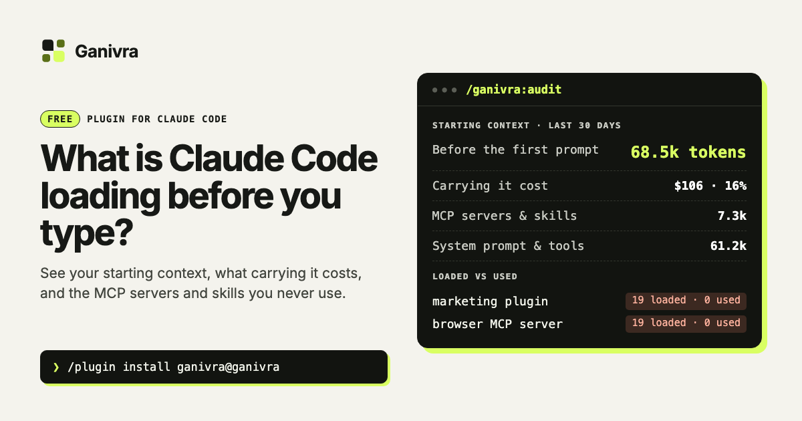

# Claude Code context & cost audit

**What is Claude Code loading before you type, what does carrying it cost, and what should you turn off?**



```
/plugin marketplace add ProdMoh/ganivra-claude-plugin
/plugin install ganivra@ganivra
```

Then run `/ganivra:audit`.

The plugin practises what it preaches: it adds about 82 tokens to each session
(`claude plugin details ganivra@ganivra`).

## What you get

**`/ganivra:audit`**: the context audit.

- Tokens loaded before your first prompt: median, typical range, trend by week.
- What carrying that base cost you: loading it each session and re-reading it on every request.
- How much of it you control (MCP servers and skills) and how much is Claude Code's own system prompt.
- Loaded vs used: every MCP server and skill, how many sessions loaded it, and how many used it.
- The top three things to switch off, with an estimated saving, and a one-line summary to share.

**`/ganivra:report [--days N] [--csv]`**: where the money went, by project, model and day, plus what the
same tokens would have cost on Sonnet 5.5 and Haiku 5.5.

**`/ganivra:setup`**: a status line that's always on screen:

```
Opus 5.5 · $1.84 · ctx 71% · 5h 82% → 15:40 · today $36.99 · metering
```

Session cost, context used, plan-limit usage and reset time (Pro/Max, when Claude Code reports it),
today's total across all sessions, and the project. On subscription plans, costs show as `≈`: the API
value of your usage, not what you are billed.

## Privacy

- Everything runs locally from Claude Code's own logs (`~/.claude/projects`, or `$CLAUDE_CONFIG_DIR`).
- It reads token counts, model names, timestamps, tool and skill names, and folder names. It never
  stores or prints prompts, responses or code.
- No network requests. Prices come from a bundled snapshot of
  [llm-prices](https://github.com/ProdMoh/llm-prices) (see `as_of` in `data/prices.json`).
- The status line keeps a small cache of today's per-request costs in `~/.ganivra/claude-code/cache`.

## Data handling

| Question | Answer |
| --- | --- |
| What it reads | Claude Code's local session logs: token counts, model names, timestamps, tool and skill names, and working-directory names. Never prompt, response or code text. |
| What it stores | `~/.ganivra/claude-code/`: a copy of the status line script and price list, and a cache of today's per-request costs (reset daily). |
| What it sends | Nothing. No network requests, no telemetry. |
| Settings it changes | Only `/ganivra:setup`, and only after you confirm: it sets the `statusLine` key in `~/.claude/settings.json`. |
| Permissions | Its commands pre-approve only its own launcher, `ganivra-cc` (`Bash(ganivra-cc:*)`). |
| Remove everything | `/plugin uninstall ganivra@ganivra`, delete `~/.ganivra/claude-code/`, and remove `statusLine` from your settings if you set it. |

## How the numbers work

- Costs use Anthropic API list rates, including 5-minute and 1-hour cache writes, cache reads,
  Haiku 5.5's long-prompt rates and Opus 5.5 fast mode.
- Starting context is the first request of each session, minus a rough estimate of your first prompt
  (characters ÷ 4). Resumed sessions carry history, so the audit reports the median and the
  10th–90th percentile.
- Per-server and per-skill sizes are estimates from what Claude Code records (instructions, tool
  names, skill descriptions). Run `/context` in a session for its exact breakdown.
- "Used" counts Claude's tool and skill calls and slash commands you typed.

## For teams

Ganivra collects Claude Code usage across a team by developer, project and client, with seat-vs-API
comparisons. Setup is one settings block: <https://ganivra.com/integration>.

## Requirements

Python 3.8+ (preinstalled on macOS and most Linux). No other dependencies.

## Development

```
python3 -I bin/ganivra_usage.py audit
python3 -m unittest discover -s tests
python3 -I scripts/build_prices.py path/to/llm-prices/data/prices.csv   # refresh the price snapshot
```

MIT licensed.
